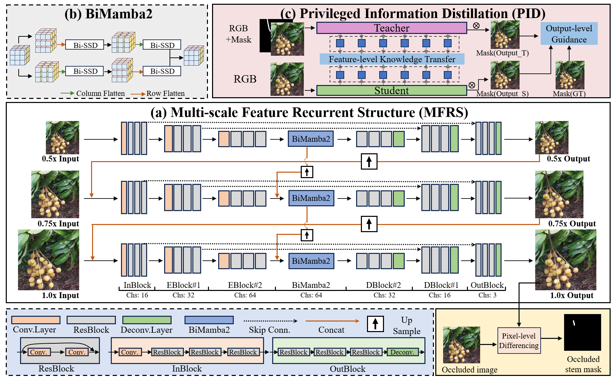
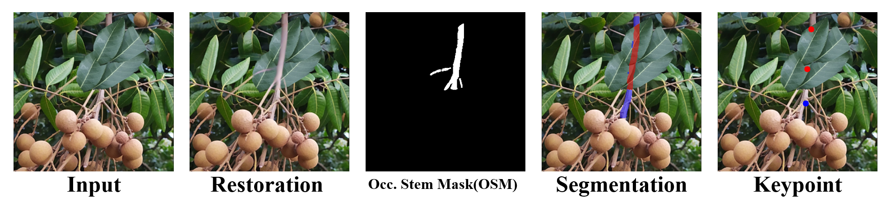

# A lightweight restoration-assisted framework for occlusion-robust longan picking stem detection

PyTorch implementation of [A lightweight restoration-assisted framework for occlusion-robust longan picking stem detection](https://www.sciencedirect.com/science/article/pii/S0168169926010616).

## Performance

           │  PSNR  │  SSIM  │                IoU-OSM              │
    OSRNet │        │        │ foreground │ background │  average  │
           │  28.91 │ 0.9576 │    62.55   │    98.61   │   80.58   │

    OSRNet  │            IoU-Stem / IoU-Occ (Seg)           │ Keypoint │
      +     │   foreground  │   background  │    average    │    AP    │
    YOLO26n │ 71.92 / 60.07 │ 98.84 / 98.57 │ 85.38 / 79.32 │   90.75  │

## Data Preparation

Keep your train and val dataset by placing images like:

    Datasets
    ├── train
    │   ├── img
    │   │   ├── T1.png 
    │   │   ├── T2.png 
    │   │   └── ...
    │   ├── lab
    │   │   ├── T1-label.png
    │   │   ├── T2-label.png
    │   │   └── ...
    │   └── mask
    │       ├── T1-mask.png 
    │       ├── T2-mask.png
    │       └── ...
    └── eval
        ├── img
        │   ├── E1.png 
        │   ├── E2.png 
        │   └── ...
        ├── lab
        │   ├── E1-label.png 
        │   ├── E2-label.png 
        │   └── ...
        └── mask
            ├── E1-mask.png 
            ├── E2-mask.png
            └── ...

Then run the script:

    data_listMask.py

Obtain the index files for the training set and validation set: train_list_mask.txt and eval_list_mask.txt

## Training OSR-Net

1.Train the teacher model first

    run trainMaskT.py
2.Then train the student model

    run trainMask-KL.py

## Testing OSR-Net:

1.Keep your test dataset by placing images like:

    TestData
    ├── Input
    │   ├── Test1.png 
    │   ├── Test2.png 
    │   └── ...
    └── Output

2.Run the test script

    run test.py

The restored images will be saved in the directory: ./TestData/Output/

## Stem segmentation:

1.Place input images in ./example/img/

2.Picking keypoint detection:
    
    run stemSeg.py

The output images will be stored in ./example/output/seg/   

3.for keypoint task:
    
    run stemPoint.py
    
The output images will be stored in ./example/output/keypoint/   
        
## Dataset Availability:
    
    The dataset can be made available upon reasonable request to the last-listed corresponding author (Jun Li) of the paper.
